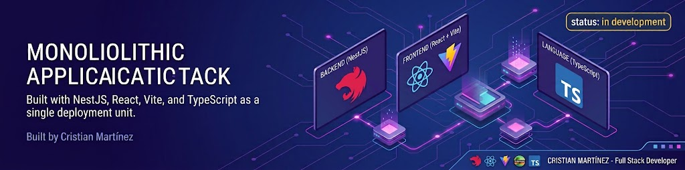

<p align="center">
 <a href="" rel="noopener">
 </a>
</p>
<h3 align="center">Incident Management System</h3>

<div align="center">

[]()
[](https://nestjs.com/)
[](https://react.dev/)
[](https://vitejs.dev/)
[](https://tanstack.com/)
[](https://zustand-demo.pmnd.rs/)
[](https://zod.dev/)
[](LICENSE)

</div>

---

<p align="center"> A web application built to manage incidents, track their status, and bring order to the way reported issues get handled.
  <br> 
</p>

## 📝 Table of Contents

- [Problem Statement](#problem_statement)
- [Idea and Solution](#idea)
- [Dependencies and Limitations](#limitations)
- [Future Scope](#future_scope)
- [Setting up a local environment](#getting_started)
- [Usage](#usage)
- [Technology Stack](#tech_stack)
- [Authors](#authors)
- [License](#license)
- [Acknowledgments](#acknowledgments)

## 🧐 Problem Statement <a name = "problem_statement"></a>

Right now, incident reports tend to live in too many places. A message here, a spreadsheet there, someone's memory somewhere else. Progress is hard to follow and records get messy fast. Here's a simple way to frame the issue.

- IDEAL: Everything lives in one place. Every incident gets registered, tracked, and resolved through a clear workflow, and anyone can see its status at a glance.
- REALITY: Reports come through informal channels. Status updates happen by hand. Information gets lost, duplicated, or forgotten.
- CONSEQUENCES: Time wasted, effort repeated, resolutions delayed. And without traceability, accountability slips.

Putting it down this way makes the problem easier to understand and much easier to solve.

## 💡 Idea and Solution <a name = "idea"></a>

The plan is straightforward: build a web app that centralizes incident reporting and management. Users register incidents, follow their progress, and always know where things stand throughout the resolution process.

Once the ideal, reality, and consequences are clear, the solution almost writes itself.

## ⛓️ Dependencies and Limitations <a name = "limitations"></a>

- The project needs a running database and a properly configured runtime environment.
- Describe each limitation in detailed but concise terms.
- Explain why each limitation exists.
- Provide the reasons why each limitation could not be overcome using the method(s) chosen.
- Assess the impact of each limitation in relation to the overall findings and conclusions of the project, and if appropriate, describe how these limitations could point to the need for further research.

## 🚀 Future Scope <a name = "future_scope"></a>

There's plenty left to build. Think notifications, roles and permissions, analytics dashboards, and integrations with other tools. This section is where those ideas go: what didn't make it this round, and what the project could reach next.

## 🏁 Getting Started <a name = "getting_started"></a>

These instructions will get you a copy of the project up and running on your local machine for development and testing purposes. See [deployment](#deployment) for notes on how to deploy the project on a live system.

### Prerequisites

- **Node.js**: `>= 22.23.4` (LTS). Using **24.x LTS** (for example `24.22.1`) is strongly recommended for the longest support cycle.
- **pnpm**: `>= 12.0.0` (the latest stable 12.x release is recommended).

> ⚠️ **Security note**: Node.js 20.x and earlier have reached end-of-life (EOL) and will no longer receive security patches. Please upgrade to the 22.x or 24.x versions mentioned above.

### Installing

Clone the repository:

```bash
git clone https://github.com/cris0d3v/sistema-incidencias.git
cd sistema-incidencias
```

## 🎈 Usage <a name="usage"></a>

Fire up the app and you're ready to go. Register incidents, look through their details, and follow their status as they move forward. That's the core loop everything else builds on it.

## ⛏️ Built With <a name = "tech_stack"></a>

- [NestJS](https://nestjs.com/) - Backend Framework
- [React](https://react.dev/) - Web Framework
- [Vite](https://vitejs.dev/) - Build Tool
- [TanStack](https://tanstack.com/) - Data Fetching and State Management
- [Zustand](https://zustand-demo.pmnd.rs/) - State Management
- [Zod](https://zod.dev/) - Schema Validation

## ✍️ Authors <a name = "authors"></a>

- [@cris0d3v](https://github.com/cris0d3v) - Idea and Initial work

See also the list of [contributors](https://github.com/cris0d3v/sistema-incidencias/contributors)
who participated in this project.

## 📄 License <a name = "license"></a>

This project is licensed under the MIT License. See the [LICENSE](LICENSE) file for details.

## 🎉 Acknowledgments <a name = "acknowledgments"></a>

- Hat tip to anyone whose code was used
- Inspiration from real-world incident management workflows
- Open-source projects and tools that support the development process
