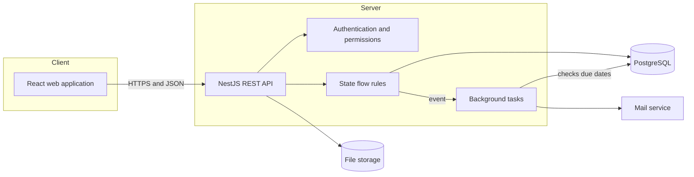
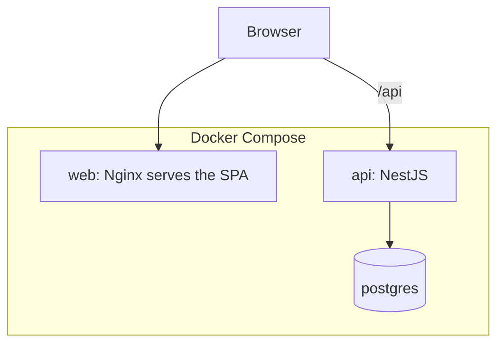

# 02. Architecture

## Main decision

A modular monolith inside a monorepo. A single deployable backend, split into modules with clear boundaries. Microservices are not used (see [ADR-0001](adr/modular-monolith.md)).

## Overview



In the MVP, background tasks and email do not exist yet. We include them in the diagram so the architecture already accounts for their place.

## Backend modules

| Module          | Responsibility                                              |
| --------------- | ----------------------------------------------------------- |
| `auth`          | Login, registration, JWT issuance and validation            |
| `users`         | User and role management                                    |
| `categories`    | Incident categories                                         |
| `tickets`       | Incident lifecycle and its state machine                    |
| `comments`      | Public comments and, from V2, internal notes                |
| `history`       | Immutable record of changes (write-only from other modules) |
| `attachments`   | File upload and download (V2)                               |
| `notifications` | Sending alerts (V2)                                         |
| `reports`       | Metrics (V2)                                                |

Dependency rule: modules communicate through exported services. No module reads another's tables directly. `history` only exposes a write method, so no other module can edit the history.

## Monorepo structure

```
incidencias/
├── apps/
│   ├── api/          # NestJS + TypeScript
│   └── web/          # React + Vite + TypeScript + Tailwind
├── packages/
│   └── shared/       # shared statuses, priorities, and response types
├── docs/             # this documentation
├── docker-compose.yml
└── .github/workflows/ # CI: lint and tests
```

`packages/shared` avoids writing statuses and priorities twice. If they change, the compiler warns on both sides.

## Deployment



- A single `docker-compose.yml` brings up the three services.
- Production: API and database on a provider with a free or low-cost plan. The web app as a static site.
- Environment variables are defined in `.env` (not versioned) and documented in `.env.example`.

## Relevant technical decisions

- Shared types in `packages/shared`: [see ADR-0003](adr/shared-types.md).
- PostgreSQL database: [see ADR-0002](adr/postgresql.md).
