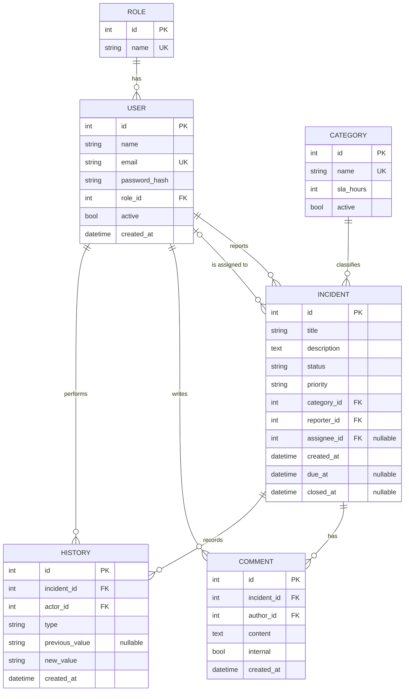

# 03. Data Model (DRAFT)

## Entity-relationship diagram

Attachments (`ATTACHMENT`) are added in V2 and are not part of this initial model.

## Entities

### ROLE

Fixed values: `user`, `agent`, `administrator`. Seeded with a migration.

### USER

- `email` is unique and stored in lowercase.
- `password_hash` is never returned in any API response.
- `active = false` disables access without deleting the user's history. Users who have incidents are not deleted.

### CATEGORY

- `sla_hours` defines the category deadline. If a category does not have one, the priority deadline is used.
- Categories are not deleted if they have incidents. They are deactivated with `active = false`.

### INCIDENT

- `status` takes values from the state machine ([see 04-state-flow.md](state-flow.md)).
- `priority` takes values `critical`, `high`, `medium`, `low`.
- `due_at` is calculated when the incident is created, based on its priority or category. It is the basis for the SLA in V2.
- `closed_at` is filled only when moving to _Closed_.

### COMMENT

- `internal` is in the model from the start to avoid requiring a migration in V2, but in the MVP it always equals `false`.

### HISTORY

- It is write-only. It has no `UPDATE` or `DELETE` from the application.
- `type` indicates what changed: `status`, `priority`, `assignee`, `category`.
- Each change is saved in the same transaction as the modification that causes it.

## Database-level constraints and permissions

| Rule                  | Implementation                                                   |
| --------------------- | ---------------------------------------------------------------- |
| Unique email          | Unique index on `user.email`                                     |
| Valid status          | `CHECK (status IN (...))` on `incident.status`                   |
| Valid priority        | `CHECK (priority IN (...))` on `incident.priority`               |
| Immutable history     | Application permission without `UPDATE` or `DELETE` on `history` |
| Referential integrity | Foreign keys with `ON DELETE RESTRICT`                           |

## Recommended indexes

- `incident (status, priority)`: for agent queue filters.
- `incident (assignee_id)`: for the "my incidents" view.
- `incident (reporter_id)`: for the user view.
- `comment (incident_id, created_at)`: for the timeline.
- `history (incident_id, created_at)`: for the timeline.
